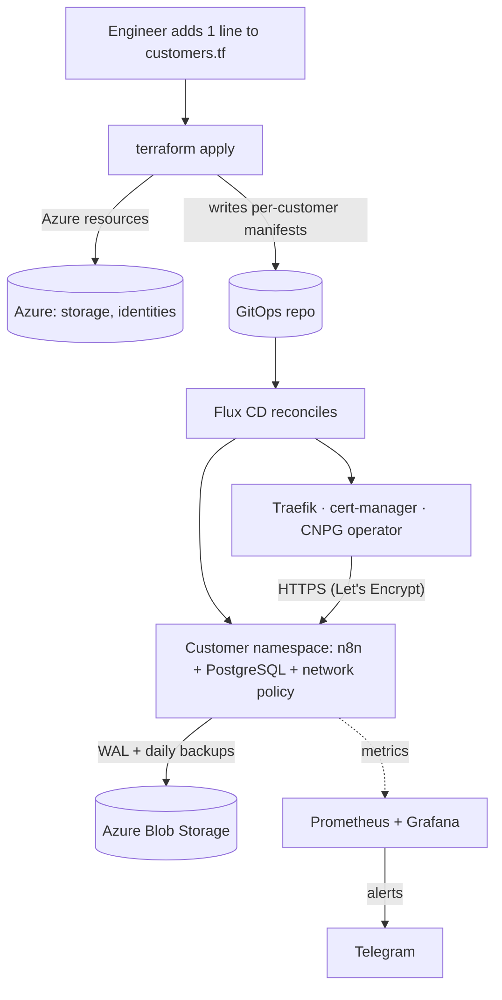

**In one line:** a platform on Azure Kubernetes Service (AKS) where onboarding a new customer, with an isolated namespace, PostgreSQL database, TLS ingress, daily backups, network policies, and alerts, is **a 1-line Terraform change**.

**Context:** built phase by phase in the KubeCraft Engineering Program's guided "Mercury Workflows" platform project. The program supplied the reference design; I built, deployed, operated, and debugged every phase myself on my own Azure subscription, and wrote up each failure I hit.

[Repository →](https://github.com/bmacharia/kubernetes-platform-engineering) · [[decisions|Decision records →]] · [[HomeLab/Projects|All projects →]]

---

## 1. The problem

A fictional SaaS company, Mercury Workflows, sells hosted [n8n](https://n8n.io) workflow automation. Every customer needs their own isolated instance with a database, HTTPS, backups, and monitoring. Built by hand, each new customer means hours of copy-pasted YAML, drifting configuration, and a growing chance that one tenant can reach another's data.

The goal: make onboarding **repeatable, isolated, and recoverable**, so the platform scales with customers instead of with engineer hours.

## 2. Success criteria

**A fully functional multi-tenant AKS platform.** In practice, "fully functional" meant every one of these working end to end:

- Onboarding a customer takes **one change in Git**, with no manual `kubectl`.
- Each customer is **isolated**: own namespace, restricted Pod Security Standards, network policies.
- Every customer database is **backed up daily** and can be **restored from backup**.
- Failures **alert a human** in real time.

## 3. Architecture

**Git is the single source of truth.** Terraform creates the Azure resources and writes each customer's Kubernetes manifests; Flux reconciles the cluster to match Git.

### Built in 10 phases

| Phase | Focus | Outcome |
|---|---|---|
| 1 | IaC basics | Single VM and networking with Terraform |
| 2 | Terraform modules | Reusable, isolated customer environments |
| 3 | AKS | First workloads running with Cilium |
| 4 | Ingress + TLS | Traefik and cert-manager with automatic HTTPS |
| 5 | GitOps | Flux CD with dependency ordering |
| 6 | Stateful workloads | CloudNativePG with backups to Blob Storage |
| 7 | Cluster hardening | Entra ID, system/user node pools, auto-upgrades |
| 8 | Workload security | Restricted PSS and Cilium network policies |
| 9 | Observability | Prometheus, Grafana, and Telegram alerts |
| 10 | Automated onboarding | 1-line tenant provisioning |

## 4. Key decisions and tradeoffs

Summarized here; each has a full record on the [[decisions|decisions page]].

| Decision | Chosen over | Tradeoff accepted |
|---|---|---|
| CloudNativePG in-cluster | Managed Azure PostgreSQL | We own database operations: upgrades, backups, and disaster recovery |
| Flux CD (my call) | Argo CD | No built-in UI; mitigated because Argo CD can run alongside Flux for developers who want one |
| Traefik | NGINX Ingress | Smaller ecosystem; Helm naming defaults caused a real TLS incident (below) |
| Terraform generates GitOps manifests | Hand-written per-customer YAML | Terraform state and Git content are coupled; a bad apply can write bad manifests |

Flux over Argo CD was my own call: Flux keeps me on the CLI, where I already work, and it doesn't lock anyone else in, because developers who prefer a UI can still use Argo CD on top. The other three come from the program's reference design; I implemented them and the incidents below show where they bit back.

## 5. What each customer gets (data model)

| Resource | Purpose |
|---|---|
| Namespace with restricted Pod Security Standards | Isolation boundary per tenant |
| n8n deployment (non-root, probes, resource limits) | The customer's workflow engine |
| CloudNativePG `Cluster` | Dedicated PostgreSQL with HA and WAL archiving |
| Barman backups to Azure Blob Storage | Daily base backups plus continuous WAL |
| Ingress + cert-manager certificate | `https://<customer>` with Let's Encrypt TLS |
| `CiliumNetworkPolicy` | Only allowed traffic in and out of the namespace |
| Grafana alerts to Telegram | Real-time notice when the customer's workload fails |

## 6. What broke, and how I fixed it

Every failure is written up in the repository.

- **TLS certificates not served.** Every HTTPS request got Traefik's self-signed default certificate. Root cause: the Helm release name produced an IngressClass called `traefik-traefik`, so no ingress matched. Fixed by setting the IngressClass name explicitly. [Write-up →](https://github.com/bmacharia/kubernetes-platform-engineering/blob/main/mercury-workflows-sanitized/phase-5-gitops/mercury-gitops/TROUBLESHOOTING-certificates.md)
- **A customer namespace with 4 chained root causes.** A missing backup secret → a stale PVC blocking the database operator → an empty backup catalog (`no target backup found`) → n8n hardcoded to the old database service name. Each fix exposed the next. [Write-up →](https://github.com/bmacharia/kubernetes-platform-engineering/blob/main/mercury-workflows-sanitized/phase-6-cnpg/TROUBLESHOOTING.md)
- **A "missing secret" that wasn't.** The CNPG Barman plugin looked like a missing `Secret`; the real cause was a failed Helm release and a namespace ownership mismatch, so Flux never reconciled far enough to create it. [Write-up →](https://github.com/bmacharia/kubernetes-platform-engineering/blob/main/mercury-workflows-sanitized/phase-6-cnpg/gitops/apps/cnpg-plugin-barman-cloud-troubleshooting.md)
- **Flux not syncing.** The `GitRepository` pointed at the wrong URL in `main.tf`. [Write-up →](https://github.com/bmacharia/kubernetes-platform-engineering/blob/main/mercury-workflows-sanitized/phase-5-gitops/mercury-gitops/infrastructure/controllers/base/TROUBLESHOOTING.md)

## 7. Results

- **Onboarding is a 1-line change:** add a name to `customers.tf`, run `terraform apply`, and Flux brings the customer live with TLS, a database, backups, and alerts.
- **Disaster recovery tested, not assumed:** in a [DR lab](https://github.com/bmacharia/kubernetes-platform-engineering/blob/main/mercury-workflows-sanitized/phase-6-cnpg/DR-LAB.md) I seeded data, took a backup, destroyed the database, and restored it from Azure Blob Storage through a Git commit that Flux reconciled.
- **Decommissioned on purpose:** I tore the Azure environment down after it ran successfully to stop paying for managed cloud, and kept building on my local k3s cluster.

## 8. How I used AI

I used **Claude Code** as a reasoning partner for dependency ordering. Before running `terraform apply`, I worked through which resources had to exist and be healthy before the next one could be created: for example, the AKS cluster before the Flux extension, the CNPG operator before any customer database, and secrets before the workloads that read them. It also helped me draft the Phase 3 n8n deployment plan, which is kept in the repo.

Running each apply, checking the results, and debugging what broke were mine; the incidents above are written up from my own troubleshooting.

## 9. What I'd change in v2

- **A Python CLI for onboarding.** Not every developer knows Terraform. A small CLI (for example, built with Typer) would let anyone onboard a customer with one command, and it would take manifest generation out of Terraform so Terraform only manages infrastructure.
- **Renovate for version updates.** Helm charts, operators, and images go stale quickly, and security fixes matter most. Renovate opens a pull request for each new version so updates are reviewed and applied promptly instead of forgotten. I already run it on my [pi-cluster](https://github.com/bmacharia/pi-cluster).

## 10. What's next: the same platform on AWS and GCP

To learn how the design carries across clouds, I'm rebuilding the same 10 phases on **AWS (EKS)** and **GCP (GKE)**. The phase-by-phase service mapping is already written, from AKS to EKS and GKE, Blob Storage to S3 and Cloud Storage, and Azure RBAC to IAM, including the Terraform provider changes: [cloud translation guide →](https://github.com/bmacharia/kubernetes-platform-engineering/blob/main/mercury-workflows-sanitized/cloud-translation-aws-gcp.md). In progress; each build will get its own write-up when it's public.

---

**Related:** [[Level-Triggered vs Edge-Triggered: What Electrical Engineering Can Teach Us About Kubernetes]] explains the reconciliation model Flux and the CNPG operator rely on.
